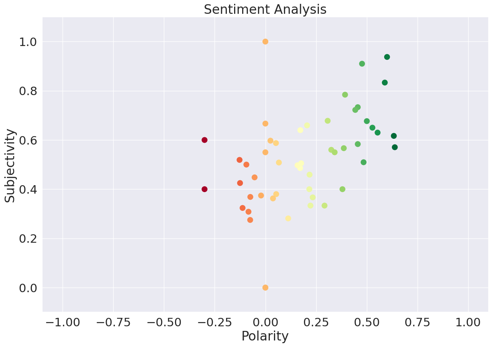
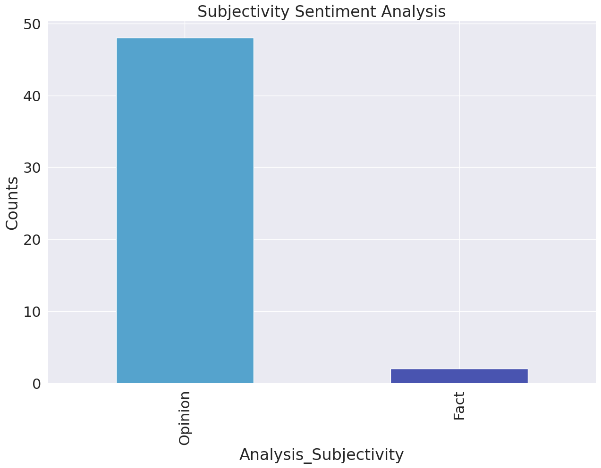

# Airport Customer Feedback Analysis Using Natural Language Processing

## Project Overview

This project explores how Natural Language Processing (NLP) can be applied to airport customer feedback to identify sentiment, examine subjectivity, discover recurring discussion topics, and visualise patterns in textual data.

The analysis uses Python-based text preprocessing, sentiment analysis, topic modelling, and exploratory visualisation techniques.

## Project Objectives

- Clean and preprocess airport customer comments for NLP analysis.
- Classify feedback using sentiment polarity and subjectivity.
- Explore recurring themes through topic modelling.
- Visualise patterns in customer feedback.
- Demonstrate a reproducible NLP analysis workflow using Jupyter Notebook.

## Technologies and Libraries

- Python and Jupyter Notebook / Google Colab
- Pandas and NumPy for data processing
- NLTK and regular expressions for text preprocessing
- TextBlob for polarity and subjectivity analysis
- Scikit-learn for text vectorisation and topic modelling
- Gensim and pyLDAvis for topic modelling exploration
- Matplotlib, Seaborn and WordCloud for visualisation
- SciPy and NetworkX for exploratory analysis

## Methodology

### 1. Data Preparation

Customer feedback text is loaded from an Excel workbook. Text preprocessing prepares the comments for analysis, including cleaning and tokenisation.

### 2. Sentiment Analysis

TextBlob is used to estimate sentiment polarity and subjectivity. Polarity is used to distinguish positive, negative and neutral sentiment, while subjectivity indicates the degree to which language expresses subjective opinion.

### 3. Topic Modelling

Text vectorisation and Latent Dirichlet Allocation (LDA) are used to explore recurring themes in customer comments.

### 4. Data Visualisation

The notebook contains exploratory visualisations for examining word frequencies, sentiment distributions and other text-analysis outputs.

## Visualisations

### Sentiment Polarity Distribution

### Sentiment Polarity Distribution

### Subjectivity Analysis

## Dataset Information

The included Excel workbook contains reconstructed demonstration comments and simulated analysis fields. It is not the original scraped dataset. Results produced using this workbook should be interpreted as demonstrations of the NLP workflow rather than independently verified findings about airport customers.

## Run the Analysis

1. Open the Jupyter notebook in Google Colab or Jupyter Notebook.
2. Install the required Python libraries.
3. Upload the accompanying Excel workbook.
4. Execute the notebook cells in order.
5. Review the generated sentiment, topic-modelling and visualisation outputs.

## Project Files

- `Data_Project_Runtime_Fixed.ipynb` — Python NLP analysis notebook.
- `synthetic_airport_feedback_demo.xlsx` — reconstructed demonstration dataset.
- `visualizations/` — exported analysis charts.

## Future Improvements

- Evaluate sentiment classification against manually annotated feedback.
- Improve topic coherence and interpretation.
- Expand the dataset with appropriately sourced customer feedback.
- Develop an interactive dashboard for exploring results.

## Author

Ryan Tinashe Hwati

[GitHub Profile](https://github.com/ryantinashe)

## Project Status

Exploratory NLP portfolio project.
  
